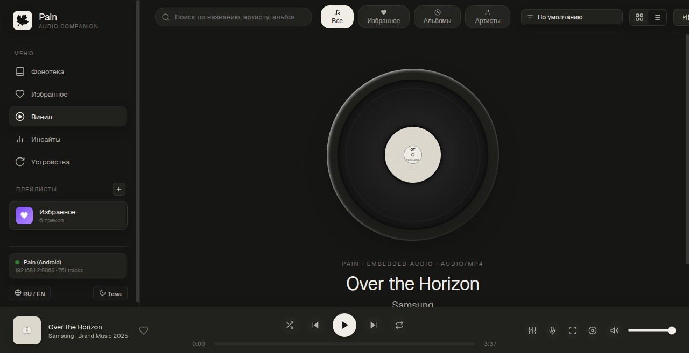
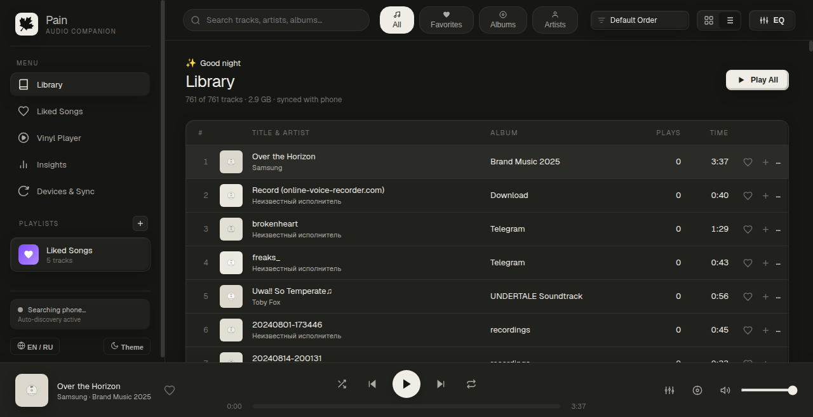
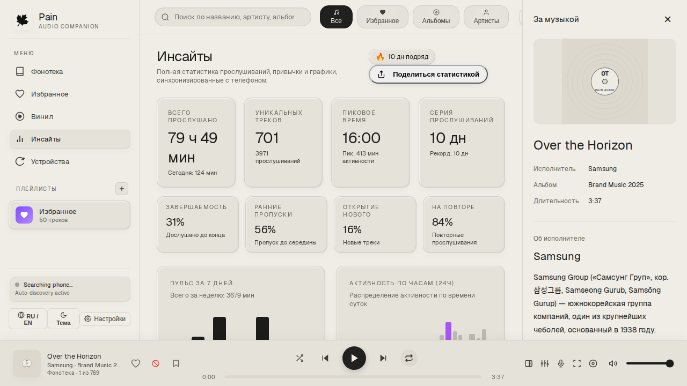
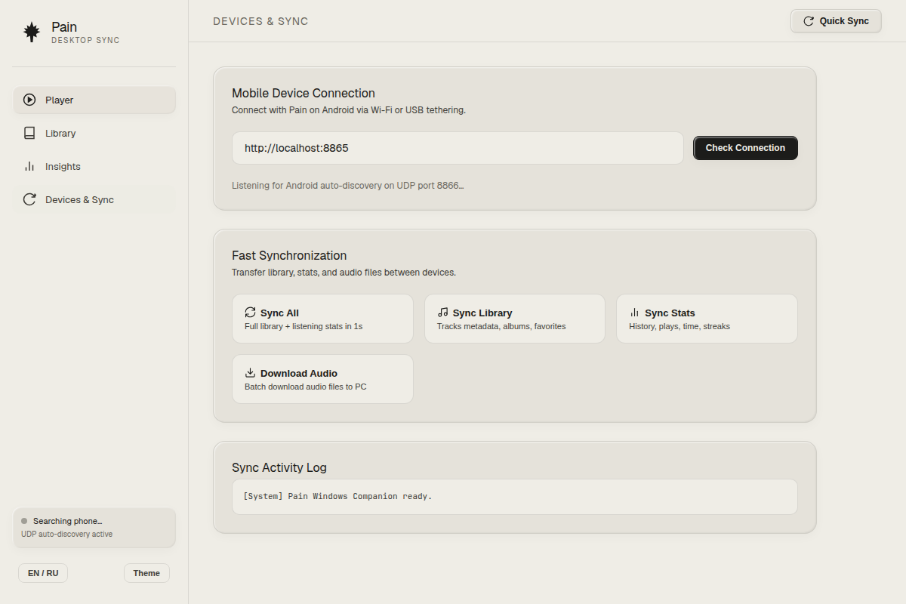
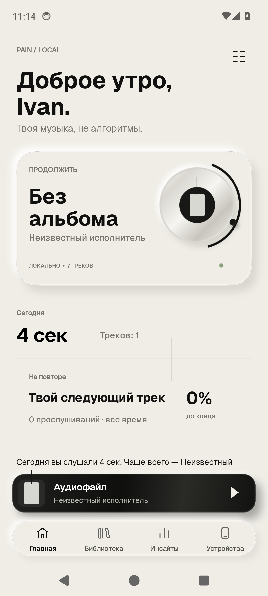
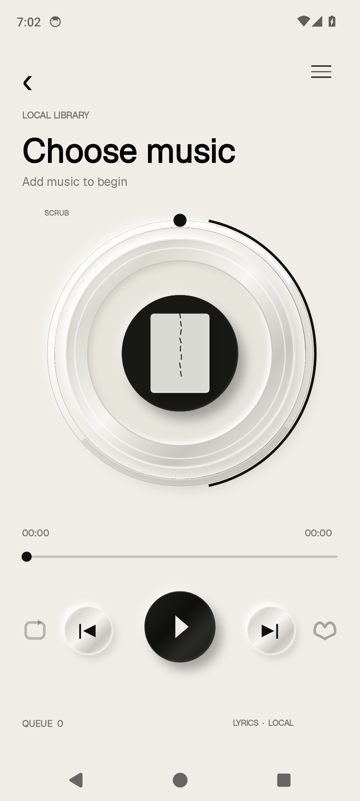
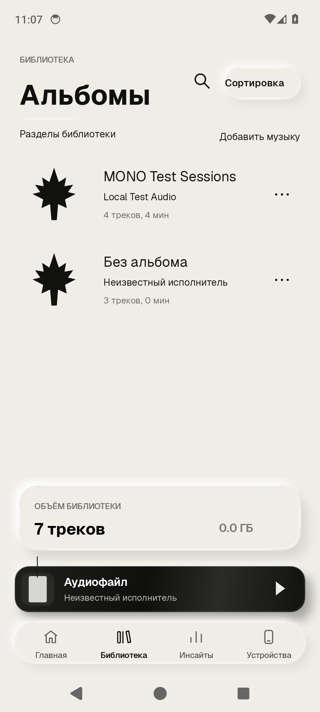
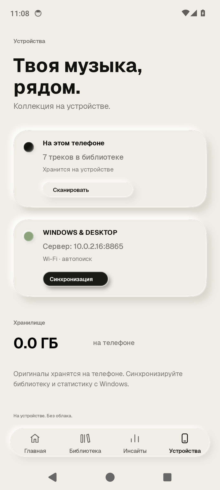

# Pain 🍁

**Pain** — бескомпромиссно минималистичный аудиоплеер для Android и сопутствующее Windows-приложение с мгновенной локальной синхронизацией по Wi-Fi.

Фирменный визуальный стиль вдохновлён эстетикой тёплой бумаги (**Warm Paper** `#EFEDE6`, чернила **Ink** `#1C1C1A`, рельефные карточки, шрифт **Geist**). Никакого неона, кричащих цветов, смайликов и лишнего декора.

---

## Возможности

- **Мобильный плеер (Android):**
  - Мгновенная отрисовка интерфейса и нулевые задержки при переключении экранов (фоновый предрендеринг и 128 МБ LruCache).
  - Бесконечный повтор текущего трека (**Loop 1**) и добавление в **Избранное**.
  - Плавная бегущая строка для длинных названий треков (Marquee с мягким затуханием).
  - Умный поиск с поддержкой опечаток и переключения раскладки (RU ↔ EN).
  - Двуязычный интерфейс (English по умолчанию, русский переключается в настройках).

- **Windows Desktop Companion:**
  - Полный аналог мобильного интерфейса: экран плеера с виниловым диском, библиотека треков, статистика прослушиваний и 7-дневный график активности.
  - Потоковое воспроизведение музыки напрямую с телефона по сети (HTTP Chunked Streaming).
  - Запуск в 1 клик через `run-windows.bat` без сложных зависимостей.

- **Сверхбыстрая синхронизация по Wi-Fi:**
  - Автоматическое обнаружение устройств в сети через UDP-протокол (порт `8866`).
  - Мгновенный перенос фонотеки, плейлистов, избранного и статистики за ~1 секунду (HTTP `8865`).
  - Пакетное скачивание аудиофайлов с телефона на ПК.

---

## Скриншоты

### Windows Desktop
<p align="center">
  
  
</p>
<p align="center">
  
  
</p>

### Android
<p align="center">
  
  
  
  
</p>

---

## Быстрый старт

### 1. Android
Скачайте готовый `Pain-v1.0.1-Android.apk` из [Releases](../../releases) и установите на телефон.

Сборка из исходников:
```bash
./gradlew assembleDebug
```

### 2. Windows Desktop
В [Releases](../../releases) доступны два варианта:
- **`Pain.exe` (Рекомендуется)**: Автономный исполняемый файл — просто скачайте и запустите двойным кликом (не требует установки Node.js или распаковки).
- **`Pain-v1.0.1-Windows.zip`**: Портативный архив со скриптом запуска `run-windows.bat`.

При запуске приложение автоматически откроет интерфейс в браузере и найдет ваш телефон в сети Wi-Fi. Нажмите **Sync All** для моментального получения всей фонотеки с телефона.

---

## Лицензия

MIT License.
