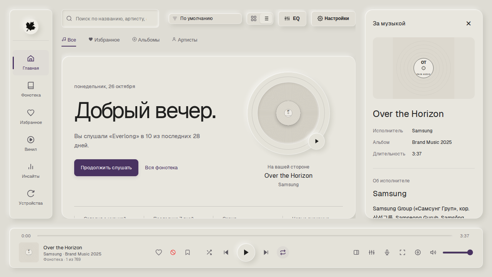

# Pain 🍁

**Pain** — минималистичный аудиоплеер для Android, Windows и Linux с автоматической синхронизацией по локальной сети Wi-Fi.

Фирменный стиль вдохновлён эстетикой тёплой бумаги (**Warm Paper**) и чернил (**Tactile Ink**): чистый интерфейс, тактильные элементы, плавная анимация и ничего лишнего.

---

## ⚡ Главные фишки

- **Полная синхронизация ПК ↔ Телефон**:
  - Локальный обмен по Wi-Fi: треки, кастомные плейлисты, лайки и история. Плейлисты, тексты с таймингами, любимые моменты и исключения Smart DJ передаются при синхронизации и фоновом подключении.
  - Изменения коллекций объединяются с предыдущим обменом; одновременная правка телефона останавливает запись до следующей попытки. Конфликтующие тексты сохраняются на ПК в `data/companion-conflicts`.
  - Недостающие файлы сохраняются в составе общего плейлиста и возвращаются на своё место после появления в библиотеке. Понадобится новая версия приложения на обоих устройствах; старый телефон продолжает обмениваться историей и лайками.
  - Двусторонняя передача треков: отправляйте любимую музыку с ПК прямо на телефон через окно настроек.
  - Лайкнул трек на компьютере — он моментально появился в «Избранном» на телефоне.
  - Объединённая статистика: чарты, время прослушивания и серии дней актуальны на всех устройствах.
  - Стриминг аудио напрямую с телефона по сети без проводов + умное кэширование на ПК для офлайн-игры.

- **PulseFlow AI & Smart DJ (Рекомендации и акустический подбор)**:
  - Нейросетевые рекомендации на основе реальных акустических эмбеддингов CLAP и векторного индекса FAISS.
  - Умное построение очереди воспроизведения: переходы учитывают тональность, акустическую текстуру, темп (BPM), историю прослушиваний и явные пропуски.
  - Фоновый расчет в Web Worker исключает любые зависания интерфейса даже при мгновенных переключениях.
  - Пакетный акустический анализ фонотеки в фоновых системных потоках без нагрузки на плеер.

- **Отдельный режим «Весь мой вкус» на ПК**:
  - Настройки → Режим подбора → «Весь мой вкус · обучение по истории», затем Smart DJ. Работает локально поверх уже готовых CLAP-векторов, тембра, спектрального контраста и истории; новые нейросетевые веса не скачиваются.
  - Цель обучения — фактически прослушанная уникальная доля трека. Текущий лайк — отдельное положительное наблюдение. Пропуск сам по себе не становится штрафом, запретом жанра или отрицательным весом исполнителя. Незавершённые текущие записи не выдаются за окончательные оценки.
  - Bootstrap-модели CART выбирают по всему доступному вкусу. Размер листа и необходимость циклического контекста локального времени выбираются на последующей по времени истории. Правил «после 12 — спокойное» нет.
  - Частотный baseline участвует в самом выборе. Сохраняется его вероятность каждой группы с одинаковым числом дослушиваний и действующим лайком; внутри группы используется bootstrap Thompson sampling с Лапласовским сглаживанием конечного ансамбля. Байесовская смесь с исходным baseline обновляется только по реально доступным исходам ранее сделанных прогнозов. Это не гарантия субъективного попадания в любую песню.
  - В непрерывной фонотеке с повтором всех треков доступны возвращения к знакомой музыке без обязательного обхода всей библиотеки. Конечные очереди, плейлисты, исключения, повтор одного трека и явно выбранная подборка сохраняют свои правила. Фиксированной квоты открытий нет.
  - В окне вайбов — краткая причина и раскрываемые подробности сохранённого решения. Вайб сохраняет измеренный профиль и доступный CLAP-отпечаток; поэтому новый режим может использовать его после удаления исходного файла. При отсутствии CLAP остаётся измеренный акустический профиль. Текст объяснения не пересчитывается задним числом по новому вайбу.
  - Обучение и подбор работают в отдельном процессе с одним потоком CPU; процесс не загружает Torch. Повторный подбор использует готовую модель, новые исходы обновляют её в фоне. Во время первого обучения, обновления и при недоступности модели очередь сразу использует частотный fallback. При выходе из приложения процесс завершается.
  - [Методика и честные результаты проверки](docs/personal-recommendations-validation.md). В первоначальном свободном ранжировании сложная модель проиграла частотной; основной системой этот вариант не оставлен.

- **Единый учёт прослушивания**:
  - Промежуточное сохранение обновляет одно событие, не закрывая его и не создавая новое при возобновлении звука. Повторный запуск песни получает новый ID.
  - Синхронизация объединяет доказанные совпадения ID или пары «трек + начало», сохраняет связи между ID после записи/чтения JSON и принимает их на Android. Время и уникальное покрытие берутся по максимуму снимков, не суммируются повторно. Близость временных отметок сама по себе не повод удалять реальные повторные прослушивания.

- **Караоке и текст песен**:
  - Синхронизированный построчный текст (.lrc и локальное хранилище) с плавной подсветкой текущей строки.
  - Автопоиск текущей песни в LRCLIB на ПК и Android, с отключением и локальным кэшем. Тайминги принимаются только для совпадающего названия, исполнителя и длительности записи; ручной текст сохраняет приоритет.
  - Встроенный редактор отметок времени прямо во время прослушивания — полностью автономно и без интернета.

- **Оценки песен и Discord на ПК**:
  - В колонке «За музыкой» отображаются опубликованные оценки конкретной песни: MusicBrainz, резервные BestEverAlbums и CritiqueBrainz. Рядом указаны число голосов, источник и издание; последняя найденная оценка доступна офлайн. Баллы альбомов и исполнителей не подставляются вместо оценки песни.
  - «Настройки → Показывать музыку в Discord»: название, исполнитель, обложка или логотип PAIN, прогресс, пауза, отметки избранного и Smart DJ. Кнопки позволяют найти песню и открыть страницу PAIN.
  - Нужен настольный Discord с разрешённым отображением активности. Подключение идёт через локальный IPC; личные токены, бот и платная подписка не требуются. В новой установке публикацию включает сам пользователь; выключение убирает статус.

- **Медиатека и умное управление**:
  - Мгновенная загрузка (0 мс) и плавная работа интерфейса без рывков благодаря чанковому стримингу строк и кешированию DOM.
  - Автоматический поиск обложек в интернете: фоновый подбор артов альбомов через iTunes API без задержек воспроизведения.
  - Два режима отображения: крупная сетка карточек с обложками или аккуратный список строк.
  - Сортировка по артистам, альбомам, популярности, названию и длительности.
  - Возможность удалять треки из локального кэша в один клик.

- **Избранное с живой аурой и кастомизацией флюида**:
  - Бесшовный экран любимых треков с плавно текущим анимированным градиентом и матовым стеклом.
  - Настройка цвета под свой вкус: готовые стильные палитры (Neon Blue, Emerald, Amber, Sakura и др.) или свободный выбор любого HEX-оттенка.
  - **Smart BPM Sync**: умная синхронизация динамики и мягкой пульсации флюида ровно под темп играющей композиции.

- **Подробная статистика (Insights)**:
  - 24-часовой циферблат активности (в какое время суток ты чаще слушаешь музыку).
  - 7-дневный пульс недели, ударный режим (Daily Streak), процент дослушиваний и переключений.
  - Топ любимых треков и артистов с возможностью запуска прямо из чарта.

- **8-полосный эквалайзер и умный EQ**:
  - Тонкая настройка частот + готовые пресеты (Bass Boost, Rock, Electronic, Vocal Warmth, Flat).
  - «Умный EQ» работает поверх Bass Boost, другого пресета или ручной настройки. Можно менять пресет и полосы, не выключая автоматику. Ползунки показывают итоговую кривую; подпись отдельно сообщает автоматическую поправку. При отключении возвращается последняя ручная основа.
  - Сравнение спектра использует стандартное отношение мощностей `10 × log10(reference / source)`. Эталон — нормализованные медианы трёх измеренных диапазонов фонотеки, без текущего трека и дублей. Измеренное стандартное отклонение защищает от реакции на меняющуюся аранжировку; это запас по изменчивости, не доверительный интервал. Жанр и исполнитель не задают пресет.
  - Автоматические поправки ограничены ±1 дБ на измеренный диапазон, суммарная характеристика — 3 дБ. Запас по усилению рассчитывается уже для сочетания пресета и поправки. На ПК проверяется реальная характеристика фильтров Web Audio, на Android используется консервативная сумма положительных усилений. При нехватке данных работает выбранный пресет.
  - Сохранённый анализ применяется сразу. Тот же анализатор воспроизведения уточняет текущий участок после 10 секунд наблюдений, без дополнительного декодирования и таймера. Перемотка и смена файла сбрасывают участок; скрытое окно и максимальная экономия используют сохранённые измерения. Фильтры меняются плавно, повторная одинаковая кривая не создаёт новых аудиособытий.
  - Переходы на ПК заранее загружают следующий трек. Для локальных файлов отдельный поток измеряет только начало и конец (до 8 секунд каждый); один декодер, ограниченные кэши и отмена при переключении. Кривые равной мощности плавно смешивают записи, измеренная энергия уменьшает лишнее усиление при наложении, цифровая тишина сокращается. Последовательные номера одного альбома сохраняют естественную границу. Без измерений остаётся обычный плавный переход; нулевое значение отключает его. Максимальная экономия использует только готовые измерения. Темп и порядок очереди не меняются.
  - Умная нормализация громкости (Smart Volume) включается отдельно. Умный EQ на ПК использует нативную компрессию пиков даже без нормализации; Android сохраняет связанный стереолимитер. Автоматическое усиление тихого сигнала в нативном компрессоре компенсируется по формуле Web Audio, поэтому защита пиков сама не увеличивает громкость. Ручная кривая возвращается при отключении автоматики.

  - Подход к бережной коррекции готовой записи и плавной работе с меняющимися участками сверён с материалами [iZotope](https://www.izotope.com/community/blog/how-to-eq-your-master) и [FabFilter](https://www.fabfilter.com/products/pro-q-4-equalizer-plug-in). Это собственный лёгкий алгоритм PAIN, а не реализация их закрытых DSP-процессоров.

- **Виниловый плеер**:
  - Экран проигрывателя с вращающейся пластинкой, обложкой трека и бегущей строкой контекста рекомендации.

- **Безопасные обновления**:
  - Pain сам проверяет новые GitHub-релизы на Android, Windows и Linux.
  - Перед установкой файл сверяется с опубликованной SHA-256; на Android окончательное подтверждение показывает системный установщик.

---

## 📸 Скриншоты

### Компьютер (Windows & Linux)
<p align="center">
  
  
</p>
<p align="center">
  
  
</p>
<p align="center">
  
  
</p>
<p align="center">
  
  
</p>

### Телефон (Android)
<p align="center">
  
  
  
</p>
<p align="center">
  
  
  
</p>

---

## 🚀 Установка и запуск

Все актуальные файлы сборки доступны в [**GitHub Releases**](../../releases/latest).

### 📱 Android
Скачай [**`Pain-v1.8.4-Android.apk`**](../../releases/latest) и установи на телефон. Pain автоматически уведомит о следующих обновлениях, сверит контрольную сумму и откроет системный установщик.

### 💻 Windows
- **`Pain-v1.8.4.exe`** — автономный GUI-файл, запускается двойным кликом (Node.js не требуется).
- **`Pain-v1.8.4-Windows.zip`** — переносной архив с ярлыком на рабочий стол.

### 🐧 Linux (Arch / Ubuntu / Debian / Fedora)
- **Готовый архив:** [**`Pain-v1.8.4-Linux.tar.gz`**](../../releases/latest). Распакуйте и запустите `./run-linux.sh`.
- **Установка в системное меню приложений:**
  ```bash
  git clone https://github.com/vansGAMee/pain.git
  cd pain/desktop
  ./install-linux.sh
  ```
  После этого Pain появится в списке приложений системы со своей иконкой, или запускается командой `pain` в терминале.

---

## Лицензия

MIT License.
