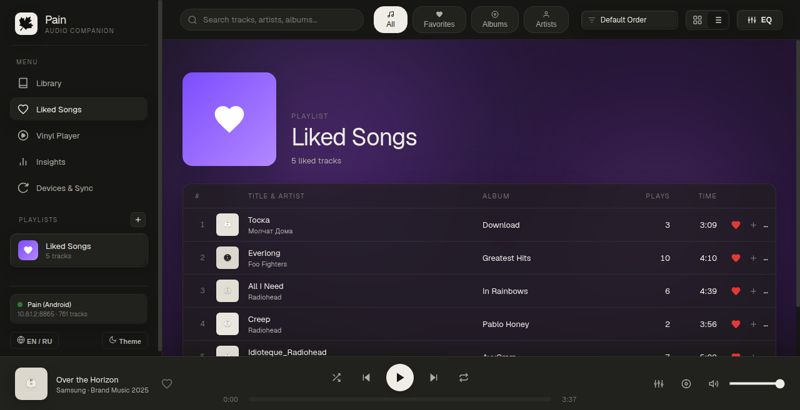
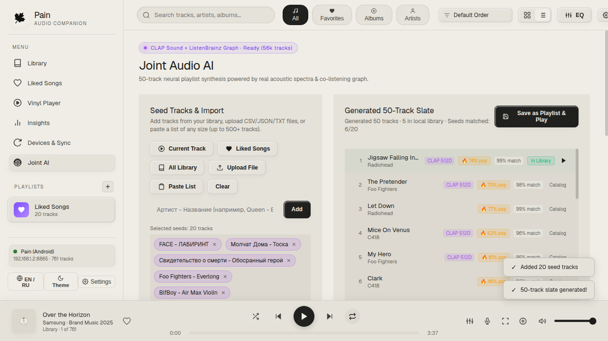
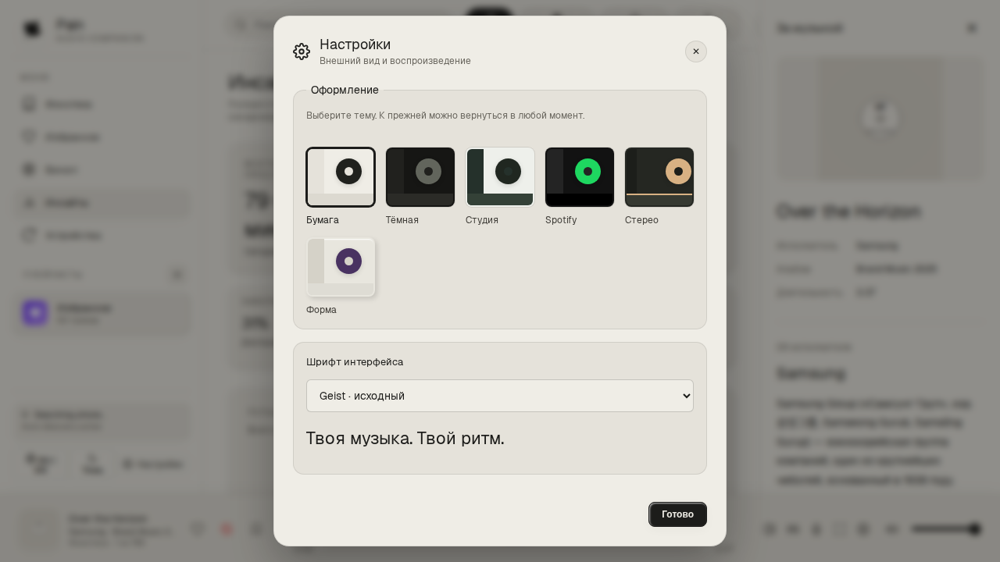
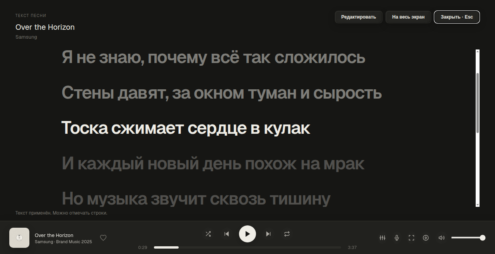
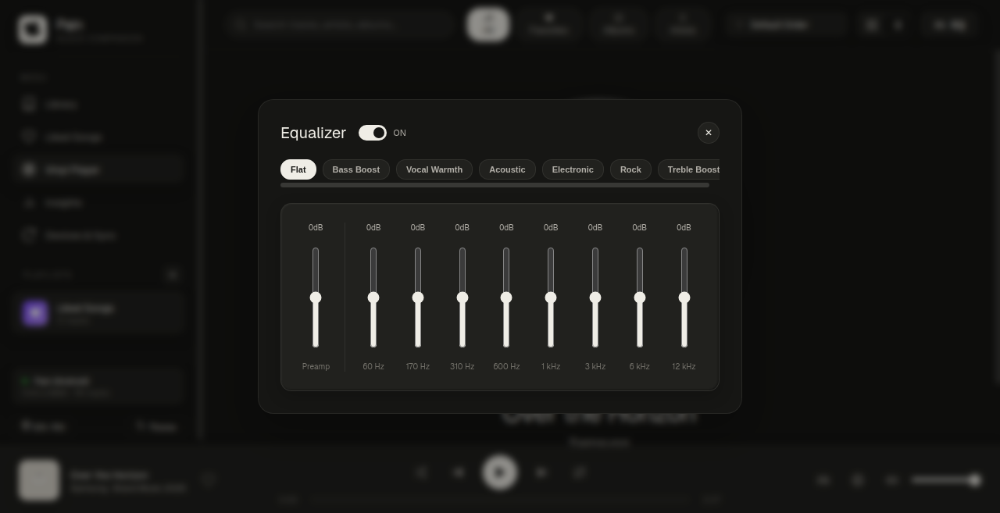
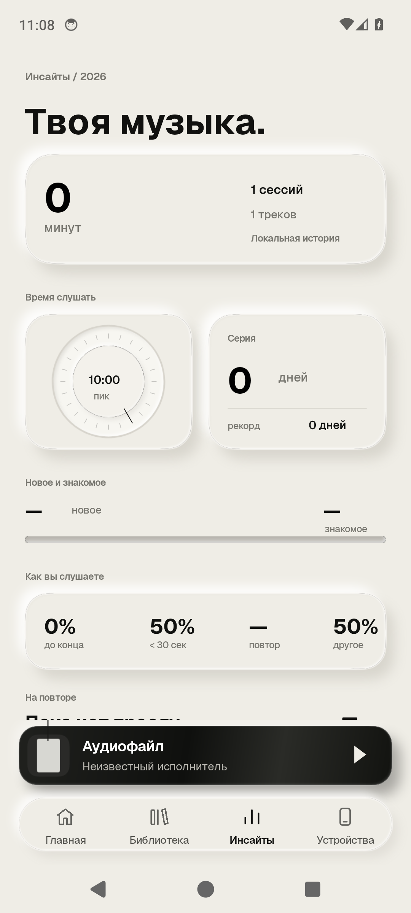
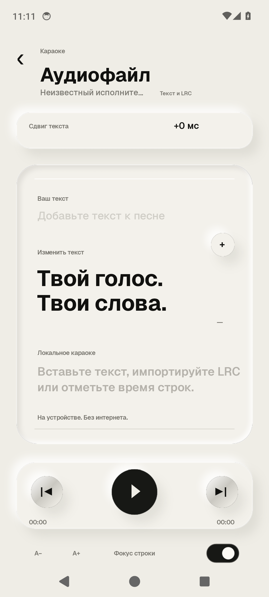

# Pain 🍁

**Pain** — минималистичный аудиоплеер для Android, Windows и Linux с автоматической синхронизацией по локальной сети Wi-Fi.

Фирменный стиль вдохновлён эстетикой тёплой бумаги (**Warm Paper**) и чернил (**Tactile Ink**): чистый интерфейс, тактильные элементы, плавная анимация и ничего лишнего.

---

## ⚡ Главные фишки

- **Полная синхронизация ПК ↔ Телефон**:
  - Всё синхронизируется в реальном времени по локальному Wi-Fi: треки, кастомные плейлисты, лайки и история.
  - Лайкнул трек на компьютере — он моментально появился в «Избранном» на телефоне.
  - Статистика объединяется: где бы ты ни слушал музыку, чарты и часы прослушивания актуальны везде.
  - Стриминг аудио напрямую с телефона по сети без проводов + умное кэширование на ПК для офлайн-игры.

- **Караоке и текст песен**:
  - Синхронизированный построчный текст (.lrc и локальное хранилище) с плавной подсветкой текущей строки.
  - Встроенный редактор отметок времени прямо во время прослушивания — полностью автономно и без интернета.

- **Медиатека и умное управление**:
  - Мгновенная загрузка (0 мс) и плавная работа интерфейса без рывков благодаря чанковому стримингу строк и кешированию DOM.
  - Два режима отображения: крупная сетка карточек с обложками или аккуратный список строк.
  - Сортировка по артистам, альбомам, популярности, названию и длительности.
  - Возможность удалять треки из локального кэша в один клик.

- **Избранное с живой аурой и кастомизацией флюида**:
  - Бесшовный экран любимых треков с плавно текущим анимированным градиентом и матовым стеклом.
  - Настройка цвета под свой вкус: готовые стильные палитры (Neon Blue, Emerald, Amber, Sakura и др.) или свободный выбор любого HEX-оттенка.
  - **Smart BPM Sync**: умная синхронизация динамики и мягкой пульсации флюида ровно под темп играющей композиции.

- **Joint Audio AI (Рекомендации и синтез плейлистов)**:
  - Нейросетевой подбор персональной подборки из 50 треков на основе реальных акустических спектров (CLAP 512D) и графа совместных прослушиваний ListenBrainz (56 000+ треков).
  - Гибкие сиды: добавление треков в один клик из «Избранного», всей фонотеки, текущей песни или загрузка файлов любого объёма (JSON, CSV, TSV, TXT, M3U).
  - Настройка параметров: фильтры популярности (Underground, Moderate, Hits), лимит композиций одного артиста, мгновенный экспорт в плейлист и запуск.

- **Подробная статистика (Insights)**:
  - 24-часовой циферблат активности (в какое время суток ты чаще слушаешь музыку).
  - 7-дневный пульс недели, ударный режим (Daily Streak), процент дослушиваний и переключений.
  - Топ-5 любимых треков и артистов с возможностью запуска трека прямо из чарта.

- **10-полосный эквалайзер**:
  - Тонкая настройка частот + готовые пресеты (Bass Boost, Rock, Electronic, Vocal Warmth, Flat).

- **Виниловый плеер**:
  - Экран проигрывателя с вращающейся пластинкой и обложкой трека.

- **Безопасные обновления**:
  - Pain сам проверяет новые GitHub-релизы на Android, Windows и Linux.
  - Перед установкой файл сверяется с опубликованной SHA-256; на Android окончательное подтверждение показывает системный установщик.

---

## 📸 Скриншоты

### Компьютер (Windows & Linux)
<p align="center">
  
  
</p>
<p align="center">
  
  
</p>
<p align="center">
  
  
</p>
<p align="center">
  
  
</p>

### Телефон (Android)
<p align="center">
  
  
  
</p>
<p align="center">
  
  
  
</p>

---

## 🚀 Установка и запуск

### 📱 Android
Скачай [**`Pain-v1.5.0-Android.apk`**](../../releases/latest) и установи на телефон. Начиная с этой версии Pain сам сообщит о следующем обновлении, проверит APK и откроет системную установку.

### 💻 Windows
В [Releases](../../releases/latest) доступны:
- **`Pain-v1.5.0.exe`** — автономный файл, запускается двойным кликом (установка не требуется, Node.js не нужен).
- **`Pain-v1.5.0-Windows.zip`** — переносной архив с ярлыком на рабочий стол.

### 🐧 Linux (Arch / Ubuntu / Debian / Fedora)
- Готовый архив: **`Pain-v1.5.0-Linux.tar.gz`**. После первого запуска следующие версии можно установить из настроек Pain.
- **Установка в системное меню приложений:**
  ```bash
  git clone https://github.com/vansGAMee/pain.git
  cd pain/desktop
  ./install-linux.sh
  ```
  После этого Pain появится в списке приложений системы со своей иконкой, или запускается командой `pain` в терминале.

---

## Лицензия

MIT License.
