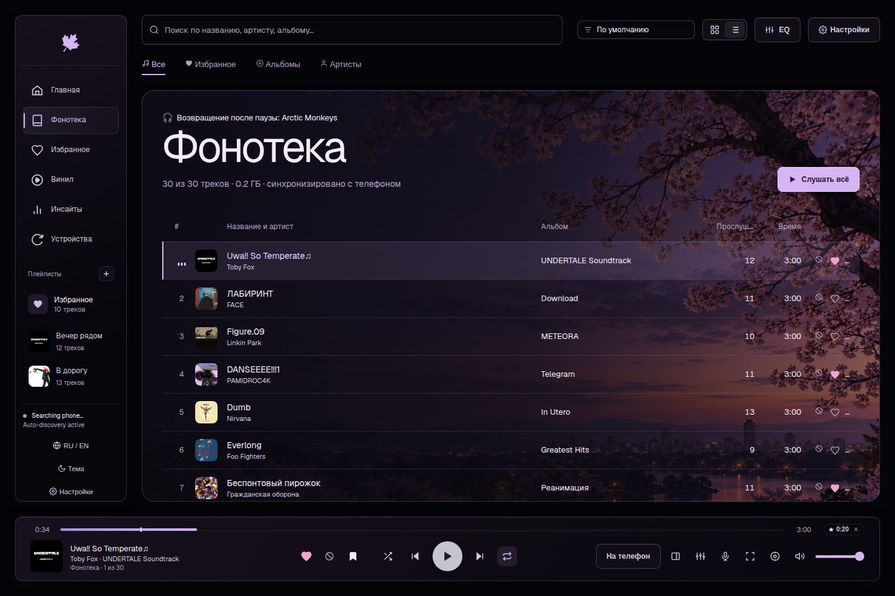
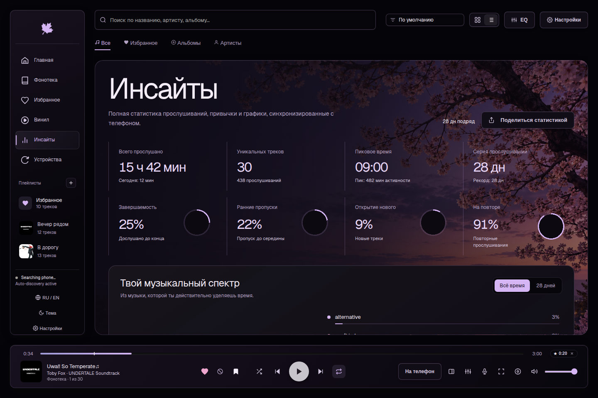
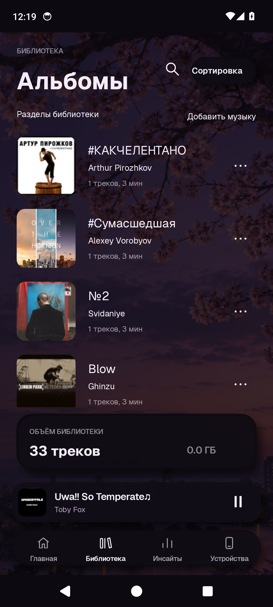
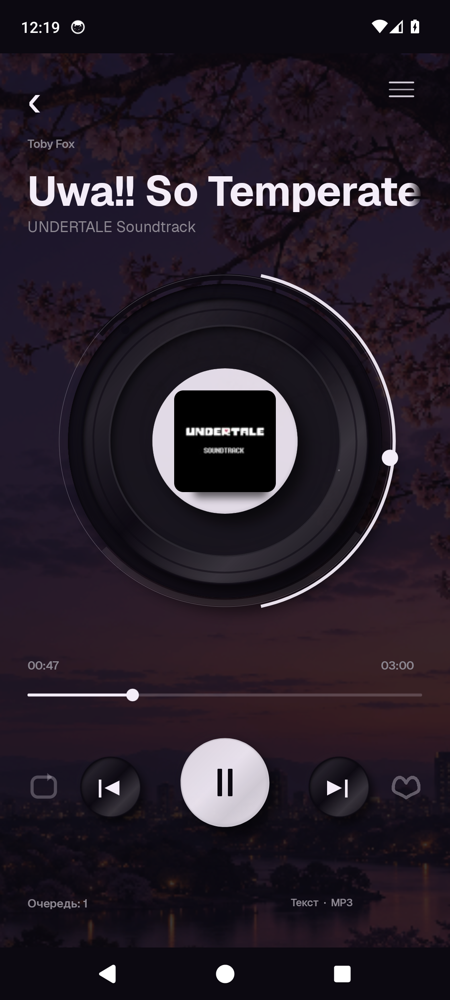

<picture>
  <source media="(prefers-color-scheme: dark)" srcset="website/assets/logo-white.png">
  
</picture>

# PAIN

**Музыкальный плеер для вашей собственной коллекции.** Windows, Linux и Android.

Слушайте локальные файлы, находите забытые песни, продолжайте на телефоне и собирайте общую очередь с друзьями. Без обязательного аккаунта и подписки.

[**Скачать PAIN**](https://github.com/vansGAMee/pain/releases/latest) · [Сайт](https://pain-player.vercel.app/) · [Руководство](https://pain-player.vercel.app/guide) · [Сообщить о проблеме](https://github.com/vansGAMee/pain/issues)



*Настоящий интерфейс приложения. На скриншотах — демонстрационная фонотека.*

## Начать слушать

Все установочные файлы и контрольные суммы находятся в [последнем релизе](https://github.com/vansGAMee/pain/releases/latest).

| Устройство | Что скачать | Как запустить |
| --- | --- | --- |
| Windows 10 и новее | `Pain-v…-Setup.exe` | Установить и открыть PAIN. Node.js не нужен. |
| Windows, без установки | `Pain-v…-Windows.zip` | Распаковать архив и запустить `pain.exe`. |
| Linux, x86-64 | `Pain-v…-Linux.AppImage` | Разрешить запуск файла и открыть его. |
| Android 8 и новее | `Pain-v…-Android.apk` | Установить APK и разрешить доступ к музыке. |

На ПК можно импортировать аудиофайлы или подключить библиотеку телефона. Для обмена между устройствами откройте PAIN на обоих и подключитесь к одной сети Wi-Fi.

## Что есть в PAIN

### Найти песню, даже если название помнится неточно

На ПК одна строка ищет по названию, исполнителю, альбому, жанрам и сохранённым текстам. Поиск понимает опечатки, переставленные буквы и слова, неправильную и смешанную раскладку, транслит, слитное написание и сокращения.

Например, `msue space dementai` находит **Muse — Space Dementia**, а `vjknfn ljvf` — **Молчат Дома**. Доступен и поиск по созвучию: некоторые английские строки можно набрать русскими буквами. Подсказка показывает, какое совпадение найдено, а результат по тексту — саму строку песни.

Можно уточнить запрос: `жанр:шугейз`, `artist:Muse`, `lyrics:"слова из песни"` или `muse -live`. Жанры берутся из тегов и сохранённых сведений о треке. Поиск по словам работает с уже найденными или добавленными текстами; описания настроения и голоса он не выдаёт за распознанное аудио.

Поиск обрабатывается в отдельном фоновом потоке и не переставляет очередь воспроизведения.

### Выбрать, что слушать дальше

**Smart DJ** использует историю и звучание музыки. На ПК доступны режимы похожего звучания, контрастного продолжения, живого подбора и обучения по всему вкусу. Сохранённые вайбы помогают вернуться к нужному характеру музыки, а панель «Почему этот трек?» показывает доступные основания выбора.

Подборка на главной играет в показанном порядке. Она меняется по кнопке «Обновить»; после неё продолжаются обычные рекомендации.

Акустический анализ выполняется локально. Для первого запуска анализа на ПК нужно загрузить движок и модель. Обычное воспроизведение доступно и без них.

### Продолжить на другом устройстве

ПК и Android обмениваются музыкой, плейлистами, избранным, историей, текстами, вайбами и любимыми моментами по Wi-Fi. Недостающие файлы можно передавать в обе стороны. На ПК доступно воспроизведение с телефона с локальным кэшированием.

Кнопка **«На телефон»** передаёт песню и позицию: продолжение появится на главной Android. Для полного набора возможностей обновите оба приложения.

### Слушать вместе

**«На одной волне»** на ПК — комната с общей очередью, предложениями треков и синхронизацией воспроизведения. Управлять может ведущий или все участники. Если у слушателя нет файла, владелец передаёт аудио через выбранный релей. Сервер не сохраняет музыку на диске; сохранение трека участником отдельно разрешает ведущий.

Можно подключить собственный сервер. [Инструкция по релею](relay/README.md) · [Как устроено совместное прослушивание](docs/listening-together.md).

### Увидеть свои музыкальные привычки

История, топ-50 треков и исполнителей, периоды прослушивания, жанровый профиль и 20 дополнительных графиков помогают увидеть, к чему вы возвращаетесь и что открываете заново. Расчёты используют сохранённые события прослушивания.

<p>
  
  
  
</p>

### Настроить звук и читать текст

- **Восемь полос EQ, пресеты и Smart EQ.** Автоматическая поправка работает поверх выбранной ручной настройки, включая Bass Boost.
- **Smart Volume и плавные переходы на ПК.** Отдельные настройки громкости и сведения треков.
- **Караоке и редактор таймингов.** Синхронный текст, если он найден, и возможность самостоятельно отметить строки на слух. На ПК несколько независимых источников; найденное сохраняется локально. Ваши правки имеют приоритет.
- **Любимые моменты.** Закладки внутри песни для возвращения к нужному месту.
- **Сведения о музыке на ПК.** Карточки исполнителей, жанры, информация о записи и опубликованные оценки с указанием источника. Доступность сведений зависит от конкретного трека и источника.
- **Discord на ПК.** Публикация текущей музыки по желанию пользователя; нужны настольный Discord и разрешённый показ активности.

## Ваши файлы, ваши настройки

Фонотека, история и звуковые профили хранятся локально. Онлайн-поиск обложек, жанров и текстов можно отключить. Для совместного прослушивания вы выбираете сервер сами.

Есть светлые и тёмные темы, таймер сна, предел громкости, уменьшение анимаций и режимы экономии ресурсов. Обновления проверяются через GitHub Releases; загрузки сверяются с контрольными суммами. На Android установку подтверждает системный установщик.

## Последние изменения

PAIN 1.9.7:

- Быстрое открытие и плавная прокрутка больших списков фонотеки, избранного, плейлистов и сетки на ПК.
- Новые треки с телефона появляются между полными синхронизациями; при сбое показывается временная подсказка.
- Сортировка «Недавно добавленные» для импорта с ПК, телефона и совместного прослушивания.
- Своя картинка для обложки плейлиста.
- Анимация загрузки и перезапуска при обновлении PAIN; фоновое скачивание сохраняет воспроизведение.
- Алгоритм рекомендаций и качество звука сохранены.

[Все изменения и сборки](https://github.com/vansGAMee/pain/releases) · [Проверка производительности и синхронизации](docs/performance-sync-validation-2026-11-07.md).

## Запуск из исходников

Для настольного приложения нужны Node.js и npm:

```sh
git clone https://github.com/vansGAMee/pain.git
cd pain/desktop
npm install
npm start
```

Android собирается из корня проекта через Gradle и Android SDK:

```sh
./gradlew :app:assembleDebug
```

[Технические сведения о персональном подборе](docs/personal-recommendations-validation.md) · [Настройка релея](relay/README.md).

## Обратная связь

[Создайте issue](https://github.com/vansGAMee/pain/issues), укажите версию PAIN, систему и шаги воспроизведения проблемы. Прикладывая логи или скриншоты, уберите личные адреса и данные.

Лицензия проекта — MIT. Лицензии сторонних компонентов сохранены рядом с их исходниками в `desktop/src/vendor/`.
